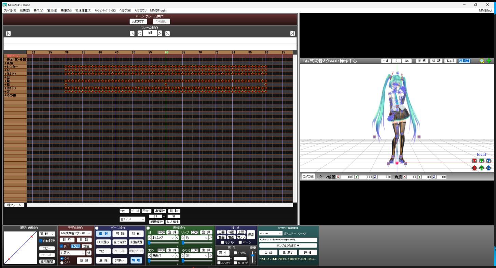
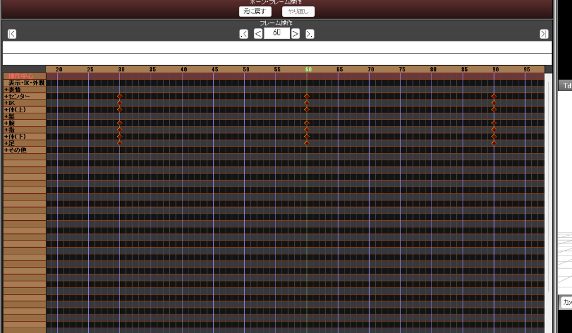
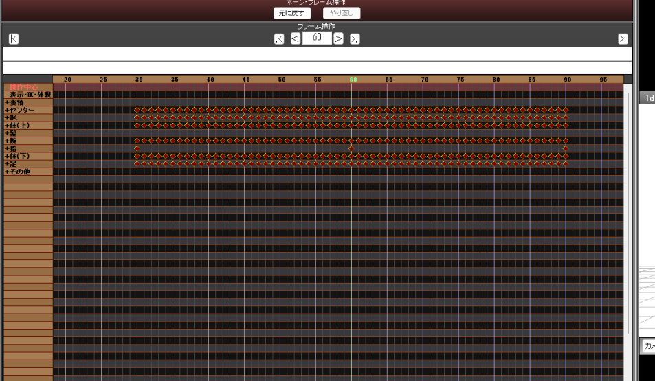
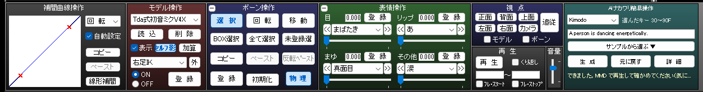
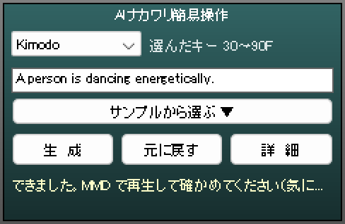
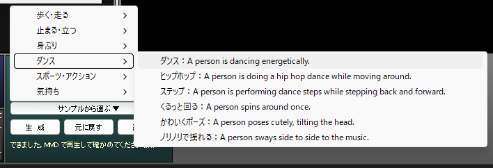
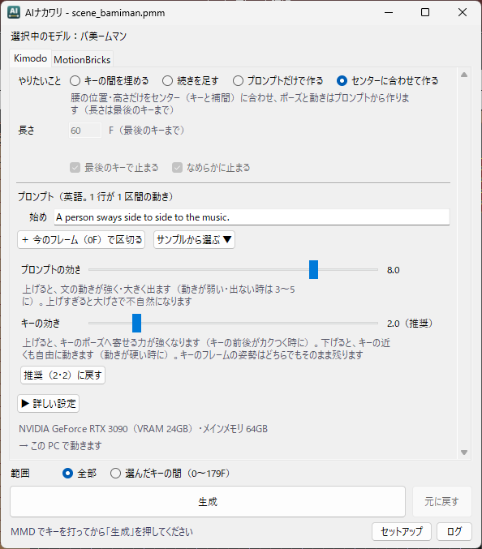

# AI Nakawari (MMD-AINakawari)

日本語: [README.md](README.md)

A plugin for MMD (MikuMikuDance) that uses AI to fill in the motion between the keys you set ("nakawari" means in-betweening).
Select keys on the timeline, then press "Generate" in the quick panel at the bottom right. The keys for the frames in between go straight into MMD's timeline.



Two NVIDIA models do the work:

- **Kimodo**: makes motion from an English sentence (a prompt). It passes through the poses of your keys and fills the gap with a motion such as "dance" or "wave".
- **MotionBricks**: makes natural in-betweens from key to key, with no prompt.

| Before generating (keys at 30, 60 and 90F) | After generating (30-90F rebuilt) |
|---|---|
|  |  |

> [!NOTE]
> This is a personal project and is not affiliated with NVIDIA.

**Using it in English**: set MMD to English (Help → English Mode) and the AI Nakawari window and panel come up in English too. If you switch modes while MMD is running, the window follows within a few seconds (what you typed is kept). MMM (MikuMikuMoving) stays in Japanese.
(The screenshots below are from the Japanese version. The buttons are named like this: 生成 = Generate, 元に戻す = Undo, 中断 = Cancel, 詳細 = Details, セットアップ = Setup, 詳しい設定 = Advanced settings.)

## Features

| | What it does |
|---|---|
| **AI in-betweening (MotionBricks)** | Connects the keys with no prompt, over 17-57 frames. For each key you can choose to stop there or pass through with momentum, and you can use plain MMD interpolation for the wrists only |
| **Make motion from a prompt (Kimodo)** | Describe the motion in an English sentence and fill in between the keys. You can write a different sentence for each section (`run / 45: stop` means "stop" from frame 45). In the details window you can also extend the motion past the last key, or generate from the prompt alone |
| **Rebuild only between the selected keys** | Rebuilds from the first selected key to the last. Motion outside the range is kept, interpolation curves included, and the ends of the range connect to the motion outside |
| **Hints other than keys** (Kimodo) | A key on the master bone alone marks "the hips pass through here". A key on a foot IK or arm IK alone marks "the hand or foot goes here" (not used for MotionBricks in-betweens) |
| **Smooth stop** | Instead of freezing dead on the last key, the motion slows down and stops naturally with MotionBricks |
| **Undo** | Returns to the motion from before generating, in one step |
| **Cancel** | While generating, the "Generate" button turns into "Cancel". Press it to stop; the keys in MMD stay as they were |
| **Non-NVIDIA GPUs** (from 0.3.0, experimental) | On AMD or Intel GPUs and the GTX 10 series, it runs through DirectML. Setup picks the backend that works on your PC. Even with no usable GPU it works, just slowly (see "Non-NVIDIA GPUs" below) |
| **Sample prompts** | If your English is shaky, pick from a list such as "Walk forward: A person walks forward." (7 categories, 44 prompts) |
| **Light** | Aimed at a PC with a 6GB VRAM GPU and 16GB RAM (prompt reading runs on the CPU, about 0.5 s per sentence) |
| **Works without Llama** | If you untick the option to write prompts freely in Setup, Llama 3 (about 8GB) is not installed and you can use the sample prompts only. It also needs about 8GB less RAM. You can add it later. If you run short of RAM after installing it, untick "Read prompts with Llama 3" in the details window to get the same setup without deleting anything |

## Requirements

| | Needed | Tested on |
|---|---|---|
| OS | Windows 10/11 (64-bit) | Windows 11 |
| MMD | MikuMikuDance 9.32 x64 (Japanese version; English Mode is fine) | 9.32 x64 |
| GPU | An NVIDIA GPU: GTX 16 series / RTX 20 series or newer, 6GB+ VRAM (about 2.6GB is used). Keep the driver up to date. For other GPUs see "Non-NVIDIA GPUs" below | RTX 3090 (24GB). Users have also reported it working on a GTX 1650 (4GB) |
| RAM | 16GB or more (prompt reading uses about 8GB; not used if you only use the sample prompts. Freed when all MMD windows are closed, or after 5 minutes of no use) | 64GB. Users have also reported it working on a 16GB PC |
| Runtime | [Microsoft Visual C++ Redistributable (x64)](https://aka.ms/vs/17/release/vc_redist.x64.exe). If it is missing, Setup points you here | |
| Disk | About 21GB (Kimodo about 15GB, MotionBricks about 6GB) | |
| Network | Only during Setup (about 12GB is downloaded) | |

**Rough requirements without Llama 3 (sample prompts only)**: 4GB+ VRAM, 8GB+ RAM, about 13GB free disk, about 4GB to download.
The AI part itself uses about 2.1GB of RAM (Kimodo 1.7GB, MotionBricks 0.4GB) and about 2.6GB of VRAM (measured on 11-10).
**I have not tested on a PC with 8GB of RAM yet. If you try it, please tell me whether it worked.**

### Non-NVIDIA GPUs (from 0.3.0, experimental)

The test generation at the end of Setup tries the backends in the order below and remembers the first one that works. There is nothing to choose.

| Backend | GPU | Speed (rough) |
|---|---|---|
| CUDA | NVIDIA GPU (GTX 16 series / RTX 20 series or newer) | About 3 s for a 2 s motion |
| DirectML | A DirectX 12 GPU (AMD Radeon, Intel Arc or integrated GPUs, NVIDIA GTX 10 series, etc.) | On an RTX 3090, the same as CUDA (3 s for a 2 s motion, 7 s for a 10 s motion) |
| No GPU | Not used (CPU only) | About 40 s for a 2 s motion, 2-4 min for a 10 s motion (Core i7-12700F) |

- The quality of the motion is the same with every backend (the same calculation on a different tool)
- With DirectML the models are converted once, the first time (about 1 minute). It uses about 2GB more disk, and Kimodo's RAM use becomes about 3GB
- The current backend is shown in the GPU check under the "Kimodo" tab of the details window (when it is DirectML or no GPU)
- **I have only verified DirectML on an RTX 3090. I have not tried real AMD or Intel GPUs or the GTX 10 series. If you try it, please tell me whether it worked** (the log files in "Troubleshooting" help me find the cause)

[MMDPlugin](https://bowlroll.net/file/121761) (ver0.41 64bit, by Oigami), the base the plugin sits on, is included in the zip. MME keeps working as before.
Under the "Kimodo" tab of the details window, a check tells you whether this PC's GPU and RAM can run it.

## Installation

### 1. Download the zip and extract it into the MMD folder
From "Assets" on the [Releases](https://github.com/BeamManP/MMD-AINakawari/releases) page, download `MMD-AINakawari-<version>.zip` (about 70MB).
"Source code (zip)" below it, and the green "Code" → "Download ZIP" on this page, are the program source and do not contain `AIナカワリ導入.cmd`.
**Close MMD first**, then extract the contents of the zip into the folder that holds `MikuMikuDance.exe`. There are three items:

```
AIナカワリ導入.cmd
MMD-AINakawari\          AI Nakawari itself (Python and the program)
plugin\MMD-AINakawari\   The DLL that MMD loads
```

### 2. Double-click `AIナカワリ導入.cmd`
(The name means "AI Nakawari install".) A black window opens and places MMDPlugin into MMD. When it says it is done (the message is in Japanese), press any key to close it.

- If Windows shows a warning such as "the publisher could not be verified", press "Run"
- If MME is installed, MME's files (`d3d9.dll`, `MMEffect.dll`, etc.) are moved to `plugin\mme\`. This follows the "using MME as well" layout in the MMDPlugin readme, and MME keeps working
- If MMDPlugin is already installed, nothing is changed
- In these cases it stops without changing anything (the reason appears in the black window): MMD is running; MMD is not the 9.32 x64 Japanese version; there is a `d3d9.dll` or `d3dx9_43.dll` that belongs to neither MME nor MMDPlugin
- If you extracted the zip outside the MMD folder, a window asks you to choose the MMD folder, and the files are copied there

### 3. Start MMD and run Setup
1. In MMD's menu bar choose "AI Nakawari" → "Open AI Nakawari window" to open the details window
2. Press "**Setup**" at the bottom of the window
3. Choose where to install (by default, `\AINakawari` on the drive with the most free space). Use a folder whose path is plain ASCII (half-width letters and digits only)
4. Read the licenses, tick the agreement box, and press the start button

Setup downloads and installs Kimodo, MotionBricks and the Python that runs them, and finally runs one test generation of each to check. About 12GB is downloaded.

- It takes about 20 minutes to 2 hours depending on your connection. The longest parts are creating Kimodo's Python environment (about 5GB) and the prompt-reading model (about 8GB)
- While it runs, the blue text at the bottom of the window shows the elapsed time and the amount downloaded and installed so far. If the number keeps growing, it is progressing
- If the connection drops, it waits a little and resumes automatically. If it still stops, wait a while and press "Setup" again
- If it stops partway (a failure, a cancel, a PC restart), press "Setup" again and it continues from the step where it stopped
- The Setup window keeps working in the background even if you close it. Press "Setup" again to bring it back

When the quick panel ("AI Nakawari quick panel") appears at the right of MMD's bottom row, you are ready.



## How to use

### The quick panel (bottom right of MMD)



1. In MMD, select a model, pose it as usual and set keys
2. On the timeline, **select the first and last keys** of the range you want to rebuild (drag a box around them, or use the range select field under the timeline; any bone's row works). The panel shows "Selected keys 30-90F"
3. At the top left, choose how to generate
   - **Kimodo**: write the motion in the prompt box (in English). If you are not sure, pick from "**Samples ▼**"
   - **MotionBricks**: no prompt is needed (the box turns gray)
4. Press "**Generate**" (or press Enter in the prompt box). When the line at the bottom shows "Generating..." and then "Done", play it back in MMD to check
5. If you do not like it, press "**Undo**", or change the prompt and press "Generate" again

- While generating, "Generate" becomes "**Cancel**". If you pressed it by mistake, or notice a wrong range or prompt, press it to stop. The keys in MMD stay as they were. Once writing to MMD has begun you can no longer cancel; in that case press "Undo" after it finishes
- The panel's "Generate" works in "Fill between keys" mode. Other modes and fine settings such as the seed are in the "**Details**" window
- When the range is "Between selected keys" (the default), "Generate" cannot be pressed until you select two or more keys. If you set the range to "All" in the details window, the panel also uses all the keys (the panel text becomes "All keys")
- While you are typing in the prompt box, MMD's shortcut keys do not work. Click outside the box (on the timeline, for example) or press Esc to leave it
- In camera, lighting and accessory modes, the panel is not shown



### The details window (the panel's "Details", or the "AI Nakawari" menu)



| Field | What it does |
|---|---|
| Tabs | **Kimodo** (generate from a prompt) / **MotionBricks** (in-betweens with no prompt). Same as the choice in the bottom-right panel |
| Mode | **Fill between keys** / **Extend** (after the end of the range, by the number of frames in Length; if the range is "All", after the last key) / **Prompt only** (does not use the poses of your keys) / **Follow center** (matches only the hip position and height to the center bone's keys and interpolation, and builds the pose and motion from the prompt. The range is the same as Fill between keys) |
| Length | For Extend, the number of frames to add. With 30-60F selected and 100 entered, frames 61-160 are generated (the window shows the area). If there are body keys where it will add, a red note tells you, and those keys are overwritten by the generated motion when you generate. Finger and facial keys are left as they are |
| Key thinning | Reduces the generated keys, but only where MMD's interpolation curves can still express the motion (on the Kimodo tab it is under Length; on the MotionBricks tab it is under "Use MMD interpolation for the wrists"). A slider with 5 levels: **Off / Fine / Normal (recommended) / Coarse / Very coarse**. Without thinning, almost every frame of the generated section gets a key (with "Normal", the whole-model key count for a 300-frame motion goes from 9807 to 1017). Keys are placed on the same frames for the whole body, and bones that are not moving there get no key. Keys you set, the ends of the range and keys outside the range are kept. The number thinned out is written to the log |
| Prompt | One line per section: the motion "from that frame to the next line". "+ Split at current frame" adds a line. "Samples ▼" is here too |
| Prompt strength / Key strength | Sliders (0.5-10). Recommended is 2 for both, and "Reset to recommended (2, 2)" restores it. If the motion from the sentence is weak, raise Prompt strength to 3-5; if the motion jerks around your keys, raise Key strength a little |
| Advanced settings | Steps, seed, post-processing (foot sliding, posture) |
| Range | **Between selected keys** (default) / **All** (from the first key to the last key) |

The prompt and the generation method (Kimodo / MotionBricks) are shared between the panel and the details window. Changing either one changes the other.

### Tips for good results
- Write prompts in English, in the form "A person + verb" (for example `A person waves with their right hand.`)
- Up to about 20 keys is a good guide. With more, the motion gets stiff because it is tied to the keys
- Kimodo handles up to 300 frames (10 seconds) per section (the few frames that carry momentum from outside the range also count, so choose a range a little shorter than that). For longer motion, split the range and generate in parts
- If a key sits just after a section boundary, the boundary is shifted back by 1 frame automatically to keep the connection
- The first generation takes an extra 10-20 seconds to load the models. From the second time on it takes about 10-15 seconds

## Updating and uninstalling

**Update**: extract the new zip over the MMD folder in the same way, and double-click `AIナカワリ導入.cmd` again. Your window settings (`MMD-AINakawari\app\work\`) are kept. Then open "Setup", and if it says an update is available, press the update button (only the steps whose version changed are redone).

**Uninstall**: close MMD, then delete the following.
- `AIナカワリ導入.cmd`, `MMD-AINakawari\` and `plugin\MMD-AINakawari\` in the MMD folder
- The location you chose in Setup (for example `D:\AINakawari\`)

MMDPlugin (`MMDPlugin.dll`, `d3d9.dll`, `d3dx9_43.dll`, `plugin\MMDPlugin\`) and the MME files moved to `plugin\mme\` stay. If you use no other MMDPlugin plugins, delete MMDPlugin's 3 files and `plugin\MMDPlugin\`, and move the contents of `plugin\mme\` back next to `MikuMikuDance.exe` to restore the original layout.

## Troubleshooting

In the details window, "**Log**" → "**Open log folder**" opens the log folder (`MMD-AINakawari\app\work\`). When you have a problem, attach the following files to a report on [Issues](https://github.com/BeamManP/MMD-AINakawari/issues). You can write the issue in English.

| File | Contents |
|---|---|
| `app.log` (and `app.log.1`) | The window log, the Setup log, and the detailed location of an error when something fails |
| `Kimodo_server.log`, `llama_server.log`, and any other file whose name ends in `_server.log` | Logs of the background servers: Kimodo, prompt reading (llama.cpp) and MotionBricks (from the last time they started) |

Common problems:
- **Setup seems stuck**: look at the time and amount in the blue text at the bottom of the window. If they are growing, it is progressing (one large component is about 2.5GB, so on some connections a single step can take over 30 minutes). If the amount does not grow for 5 minutes, press the cancel button, then press "Setup" again. Finished steps are skipped and it continues from there
- **A message says the connection seems to have been interrupted, and it stops**: wait a while and press "Setup" again. Files already downloaded are kept, so it continues. A PyTorch you installed yourself elsewhere is not used (Setup builds its own environment inside the install location)
- **It stopped working after installing, or looks wrong after being stopped midway**: open "Setup" and press the check-and-repair button. It checks what is installed (about 10 seconds) and reinstalls only what is missing. Running it on a folder that was stopped midway also repairs from where it is missing
- **Setup stops at the test generation**: update your GPU driver, then press "Setup" again
- **You changed your GPU**: open "Setup" and it says an update is available, so press the update button. It reruns the test generation and picks again the backend that works on the new GPU (1-2 minutes)
- **"Not enough free space"**: change the install location to a drive with more free space
- **MMD crashes right after starting**: check that nothing other than AI Nakawari's DLL and ini file (Python, for example) has been put under `plugin\`. MMDPlugin tries to load every DLL under `plugin\`

## Known limitations
- **Only PMX models** are supported (PMD is not). Bones are found by their standard names (center, upper body, arm, elbow, etc.). Bones a model lacks (upper body 2, neck, one arm, etc.) are skipped, and the log says that bones missing from the model are skipped (in Japanese). Generation stops only for models that lack **the center, the lower body, and a foot, knee and ankle on at least one side**, because the position and size of the body cannot be determined
- Fingers, facial expressions, hair and so on are not generated (they stay as MMD's interpolation)
- The floor is treated as one flat plane, and **the lowest foot among the keys in the range** is taken as the floor. If one key has a foot sunk into the floor, the other frames sink by the same amount too (the log warns that some keys have a sole lower than the other keys; fix the height of the foot IK). Motion where the floor height differs from key to key, such as going up or down stairs, cannot be generated cleanly
- If the poses of the keys differ a lot, the forearm or wrist can turn a long way in a single frame (for in-betweens, "Use MMD interpolation for the wrists" reduces this)
- When rebuilding only the selected range, motion outside the range is kept within a deviation of 0.05 in position and 0.5° in rotation. At sudden changes a curve cannot express, extra keys may be added outside the range too
- Key thinning ("Normal") allows a deviation of 0.05 in position and 0.5° in rotation per bone, and 0.06 (about 0.5cm) in position for the wrists, head, foot IK and similar. "Fine" is half of that, "Coarse" is double, and "Very coarse" is four times. Thinning makes generation a few seconds longer (about 6 seconds for 300 frames). For Kimodo motion where the wrists and so on jitter frame to frame, that jitter is preserved, so the keys do not reduce much (use "Coarse" to reduce them)
- Keys with physics turned off may be turned back on by generating or by "Undo" (unconfirmed)
- Only checked on the Japanese version of MMD 9.32 x64 (some parts read MMD's memory directly, so other versions do not work). English Mode on that version is fine

## License and credits
- Code in this repository: [MIT-0](LICENSE)
- Model in the screenshots: Tda-style Hatsune Miku V4X (by Tda). The model is not included. Hatsune Miku is a character of Crypton Future Media, Inc.
- [Kimodo](https://github.com/nv-tlabs/kimodo) (NVIDIA): code is Apache-2.0, the model is under the [NVIDIA Open Model License](https://huggingface.co/nvidia/Kimodo-SOMA-RP-v1.2)
- [MotionBricks](https://github.com/NVlabs/motionbricks) (NVIDIA): code is Apache-2.0, the model is under the NVIDIA Open Model Agreement
- [Meta-Llama-3-8B-Instruct](https://huggingface.co/meta-llama/Meta-Llama-3-8B-Instruct) (Meta): [Meta Llama 3 Community License](https://huggingface.co/fernandotonon/Llama-3-LLM2Vec-8B-Kimodo-TextEncoder-GGUF/blob/main/LICENSE-Llama-3.txt) and [Acceptable Use Policy](https://huggingface.co/fernandotonon/Llama-3-LLM2Vec-8B-Kimodo-TextEncoder-GGUF/blob/main/USE_POLICY-Llama-3.md) (Kimodo uses it for prompt reading). **Built with Meta Llama 3**
- [LLM2Vec](https://huggingface.co/McGill-NLP/LLM2Vec-Meta-Llama-3-8B-Instruct-mntp) (McGill-NLP): MIT
- [Llama-3-LLM2Vec-8B-Kimodo-TextEncoder-GGUF](https://huggingface.co/fernandotonon/Llama-3-LLM2Vec-8B-Kimodo-TextEncoder-GGUF) (by fernandotonon): Llama 3 and LLM2Vec converted to 8-bit (GGUF Q8_0). Used for prompt reading (Meta Llama 3 Community License)
- [llama.cpp](https://github.com/ggml-org/llama.cpp) (ggml-org): MIT. Runs prompt reading on the CPU (Setup downloads the official CPU build)
- [MMDPlugin](https://bowlroll.net/file/121761) (by Oigami): bundled in the zip (under the readme's "redistribution of the main files is free of notice for non-commercial use"). `d3dx9_43.dll` is also MMDPlugin's own file (it is not Microsoft's DirectX one)
- [mmd-mcp](https://github.com/BeamManP/mmd-mcp) (MIT-0 and others)
- The licenses of the bundled Python (python-build-standalone), uv and so on are in `MMD-AINakawari\THIRD_PARTY.txt` in the zip

The AI models (Kimodo, MotionBricks, Llama 3, LLM2Vec) and llama.cpp are not in the zip or in this repository
(the only exception is the sample prompts: their prompt-reading results for all 44 sentences, under 1MB, are kept in `mmd_ainakawari/text_cache` so that generation works without Llama). Setup downloads each from its own source (after you agree to the license on the Setup screen).

## For developers
To run from the repository, run the window in the Python environment of [mmd-mcp](https://github.com/BeamManP/mmd-mcp) (`pip install -e . numpy` and `scripts\build_native.cmd`; this needs the Visual Studio 2022 C++ tools).
- You can also run Setup by hand: `python -m mmd_ainakawari.installer.steps D:\AINakawari` (it uses the uv on your PATH)
- To point at Kimodo and MotionBricks you installed by hand earlier: `python -m mmd_ainakawari.paths F:\kimodo F:\motionbricks`
- Building the plugin: `mmd_plugin\build.cmd` (put the contents of MMDPlugin's development files `mmdplugin_dev_ver0.41_x64` in `work\mmdplugin\dev`, or give that location in the environment variable `AINAKAWARI_SDK`). Use `mmd_plugin\MMD-AINakawari.ini.example` as the ini template
- Building the release zip: `python tools\release\build_release.py --mmdplugin <MMDPlugin_v0.41_x64.zip>` (the output goes to `work\release\`)

## Development notes
How it works, the problems I hit and the numbers I measured are collected in [docs/DEVELOPMENT.md](docs/DEVELOPMENT.md) (in Japanese).
