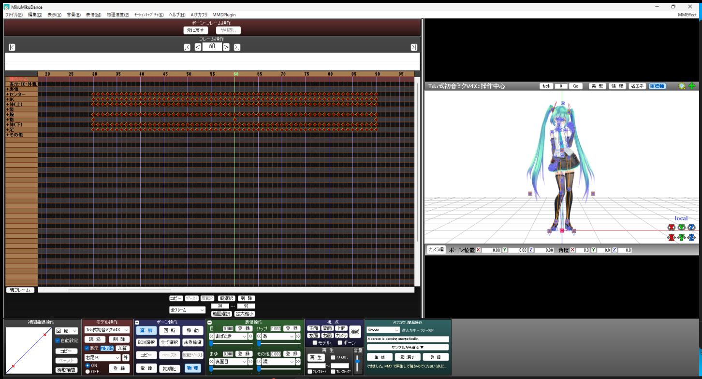
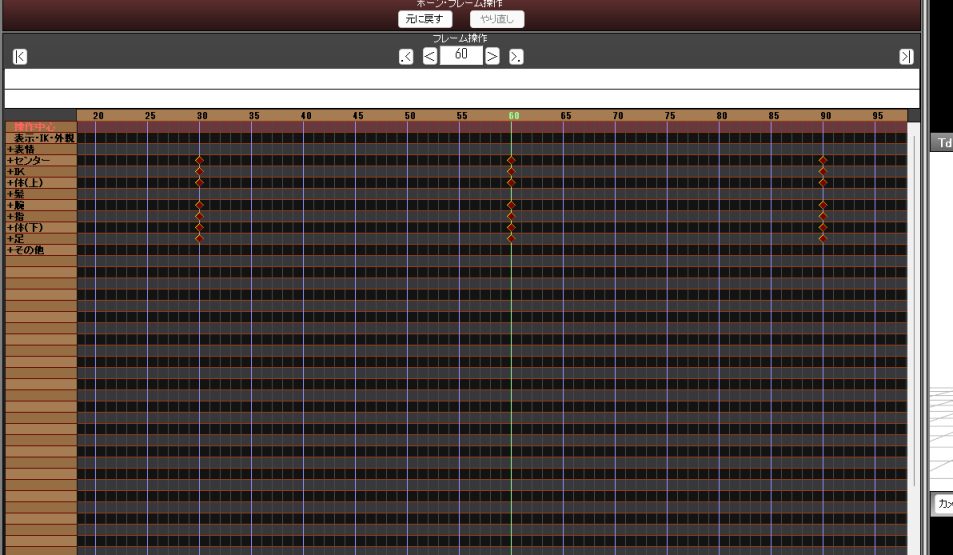
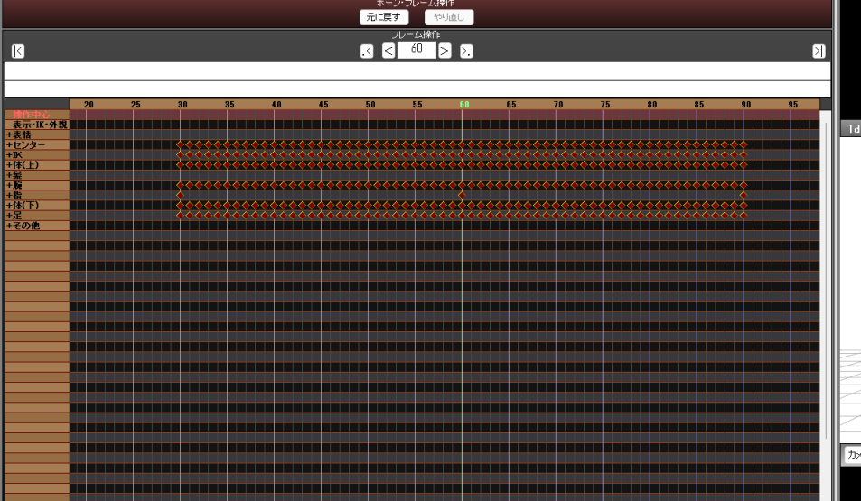
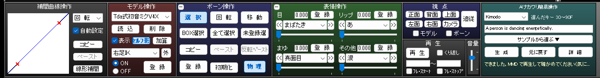
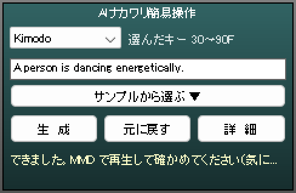
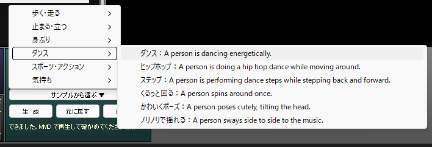
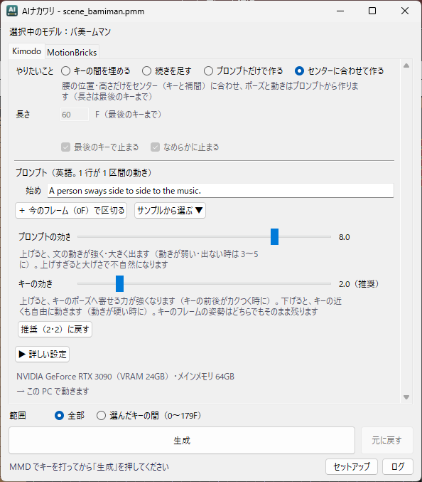

# AIナカワリ（MMD-AINakawari）

MMD（MikuMikuDance）で打ったキーとキーの間を、AI が中割りして埋めるプラグインです。
タイムラインでキーを選んで、右下の「AIナカワリ簡易操作」で「生成」を押すだけ。間のフレームのキーが、MMD のタイムラインにそのまま入ります。



中の動きを作るのは、NVIDIA の 2 つのモデルです。

- **Kimodo**: 英語の文（プロンプト）から動きを作る。打ったキーのポーズを通りながら、「踊る」「手を振る」などの動きで間を埋める
- **MotionBricks**: プロンプト無しで、キーからキーへの自然な中割りを作る

| 生成の前（30・60・90F にキー） | 生成の後（30〜90F を作り直した） |
|---|---|
|  |  |

> [!NOTE]
> 本プロジェクトは NVIDIA とは関係のない個人の制作物です。

## できること

| | 内容 |
|---|---|
| **AI 中割り（MotionBricks）** | プロンプト無しで、キーとキーの間（17〜57 フレーム）をつなぐ。キーごとに止まる／勢いのまま通る、手首だけ普通の補間、を選べる |
| **プロンプトで作る（Kimodo）** | 英語の文で動きを指定して、キーの間を埋める。区間ごとに違う文も書ける（`run / 45: stop` なら 45F から stop）。詳細の窓では、最後のキーの後ろに続きを足すことや、プロンプトだけで作ることもできる |
| **選んだキーの間だけ作り直す** | タイムラインで選んだキーの最初から最後までを作り直す。範囲の外の動きは補間曲線ごと保ち、範囲の端は外の動きにつながる |
| **キー以外の手がかり**（Kimodo） | 全ての親だけのキーは「腰がそこを通る」目印、足 IK・腕 IK だけのキーは「手足がそこに来る」目印になる（MotionBricks の中割りでは使わない） |
| **なめらかに止まる** | 最後のキーでぴたっと止まらず、MotionBricks で自然に減速して止まる |
| **元に戻す** | 生成の前のモーションに 1 回で戻す |
| **サンプルのプロンプト** | 英語が苦手でも、「前へ歩く：A person walks forward.」のような一覧から選べる（6 種類・43 個） |
| **軽い** | VRAM 6GB の GPU・メインメモリ 16GB の PC を目安にしています（プロンプトの読み取りは CPU で、1 文 0.5 秒ほど） |

## 動く環境

| | 必要なもの | 確かめた環境 |
|---|---|---|
| OS | Windows 10／11（64bit） | Windows 11 |
| MMD | MikuMikuDance 9.32 x64（日本語版） | 9.32 x64 |
| GPU | NVIDIA の GPU。GTX 16 シリーズ／RTX 20 シリーズ以降、VRAM 6GB 以上。ドライバは新しい物に | RTX 3090（24GB） |
| メモリ | 16GB 以上（プロンプトの読み取りに約 8GB 使う。MMD を全部閉じるか、5 分使わなければ空けます） | 64GB |
| ランタイム | [Microsoft Visual C++ 再頒布可能パッケージ（x64）](https://aka.ms/vs/17/release/vc_redist.x64.exe)。入っていなければ、セットアップがここへ案内します | |
| ディスク | 約 21GB（Kimodo 約 15GB・MotionBricks 約 6GB） | |
| ネット | セットアップの時だけ（約 12GB を落とします） | |

プラグインの土台の [MMDPlugin](https://bowlroll.net/file/121761)（ver0.41 64bit・おいがみ さん）は zip に入っています。MME もそのまま使えます。
詳細の窓の「Kimodo」タブの下に、この PC の GPU とメモリで動くかの判定が出ます。

## インストール

### 1. zip を落として、MMD のフォルダに展開する
[Releases](https://github.com/BeamManP/MMD-AINakawari/releases) から `MMD-AINakawari-<版>.zip` を落とします。
**MMD を閉じてから**、zip の中身を `MikuMikuDance.exe` のあるフォルダに展開します。中身は次の 3 つです。

```
AIナカワリ導入.cmd
MMD-AINakawari\          AIナカワリ 本体（Python とプログラム）
plugin\MMD-AINakawari\   MMD に読み込ませる DLL
```

### 2. `AIナカワリ導入.cmd` をダブルクリックする
黒い窓が開いて、MMD に MMDPlugin を置きます。「できました」と出たら、何かキーを押して閉じます。

- Windows の「発行元を確認できませんでした」などの警告が出た時は、「実行」を押してください
- MME が入っている時は、MME のファイル（`d3d9.dll`・`MMEffect.dll` など）を `plugin\mme\` に移します。MMDPlugin の説明書にある「MME も使う場合」の置き方で、MME はそのまま動きます
- MMDPlugin が入っていれば、何も変えません
- 次の時は、何も変えずに止まります（黒い窓に理由が出ます）: MMD が開いている／MMD が 9.32 x64 の日本語版ではない／MME でも MMDPlugin でもない `d3d9.dll` や `d3dx9_43.dll` がある
- zip を MMD のフォルダの外に展開した時は、MMD のフォルダを選ぶ窓が出て、そこへ写します

### 3. MMD を起動して、セットアップする
1. メニューバーの「AIナカワリ」→「AIナカワリの窓を開く」で、詳細の窓を開きます
2. 窓の下の「**セットアップ**」を押します
3. 入れる場所を決めます（最初は、空きのいちばん多いドライブの `\AINakawari`）。半角の英数字だけのフォルダにしてください
4. ライセンスを読んで「同意して入れます」に印を付け、「**セットアップを始める**」を押します

Kimodo・MotionBricks・それを動かす Python を落として入れ、最後に試しに 1 回ずつ作って確かめます。落とす量は約 12GB です。

- 途中で止まっても（失敗・中止・PC の再起動）、もう一度「セットアップ」を押せば、止まった段から続きます
- セットアップの窓は、閉じても裏で進みます。もう一度「セットアップ」を押すと出てきます

MMD の下の段の右に「AIナカワリ簡易操作」が出ていれば、使えます。



## 使い方

### 簡易操作パネル（MMD の右下）



1. MMD でモデルを選び、いつもどおりポーズを付けてキーを打ちます
2. タイムラインで、作り直したい範囲の**最初と最後のキーを選びます**（四角で囲む、またはタイムラインの下の「範囲選択」。どのボーンの行でもかまいません）。パネルに「選んだキー 30〜90F」と出ます
3. 左上で作り方を選びます
   - **Kimodo**: プロンプト（英語）に動きを書きます。分からない時は「**サンプルから選ぶ ▼**」から選べます
   - **MotionBricks**: プロンプトは要りません（欄は灰色になります）
4. 「**生　成**」（またはプロンプト欄で Enter）。下の 1 行に「生成中…」→「できました」と出たら、MMD で再生して確かめます
5. 気に入らなければ「**元に戻す**」か、プロンプトを変えてもう一度「生成」

- パネルの「生成」は「キーの間を埋める」で作ります。ほかの作り方や seed などの細かい設定は、「**詳　細**」の窓で選べます
- 範囲が「選んだキーの間」（既定）の時は、キーを 2 つ以上選ぶまで「生成」は押せません。詳細の窓で範囲を「全部」にすると、パネルも全部のキーで作ります（パネルの字が「全部のキー」になります）
- プロンプト欄に打っている間は、MMD のショートカットキーは効きません。欄の外（タイムラインなど）を押すか Esc で戻ります
- カメラ・照明・アクセサリのモードの時は、パネルは出ません



### 詳細の窓（パネルの「詳　細」か、メニューの「AIナカワリ」）



| 欄 | 中身 |
|---|---|
| タブ | **Kimodo**（プロンプトで作る）／**MotionBricks**（プロンプト無しの中割り）。右下のパネルの選び方と同じ |
| やりたいこと | **キーの間を埋める**／**続きを足す**（範囲の終わりの後ろへ、長さのフレーム数だけ。範囲が「全部」なら最後のキーの後ろへ）／**プロンプトだけで作る**（キーのポーズを使わない）／**センターに合わせて作る**（腰の位置と高さだけをセンターのキーと補間に合わせ、ポーズと動きはプロンプトから作る。範囲はキーの間を埋めると同じ） |
| 長さ | 続きを足す時は「足すフレーム数」。30〜60F を選んで 100 なら、61〜160F を作ります（窓に作る所が出ます）。足す所に体のキーがあると赤い字で知らせ、生成するとそのキーは作った動きで上書きされます。指・表情のキーはそのまま |
| キーの間引き | 生成したキーを、MMD の補間曲線で表せる所だけ減らします（Kimodo のタブは長さの下、MotionBricks のタブは「手首は MMD の補間にする」の下）。スライダで **しない／細かく／ふつう（推奨）／粗く／とても粗く** の 5 段。間引かないと、作った所のほぼ毎フレームにキーが入ります（「ふつう」で、300 フレームの動きのモデル全体のキーが 9807 → 1017 個）。キーは全身で同じフレームにそろえて置き、そこで動いていないボーンには打ちません。打ったキー・範囲の端・範囲の外のキーはそのまま残ります。間引いた数はログに出ます |
| プロンプト | 行ごとに「そのフレームから次の行まで」の動き。「＋ 今のフレームで区切る」で行が増える。「サンプルから選ぶ ▼」もある |
| プロンプトの効き・キーの効き | スライダ（0.5〜10）。推奨はどちらも 2 で、「推奨（2・2）に戻す」で戻せます。文の動きが弱い時はプロンプトの効きを 3〜5 に、キーの前後がカクつく時はキーの効きを少し上げます |
| 詳しい設定 | 計算の回数・seed・仕上補正（足すべり・姿勢） |
| 範囲 | **選んだキーの間**（既定）／**全部**（最初のキーから最後のキーまで） |

プロンプトと作り方（Kimodo／MotionBricks）は、パネルと詳細の窓で共通です。どちらで変えても、もう一方にも入ります。

### うまく作るコツ
- プロンプトは英語で、「A person ＋ 動詞」の形が効きます（例: `A person waves with their right hand.`）。日本語はほとんど効きません
- キーは 20 個くらいまでが目安です。多いとキーに縛られて動きが硬くなります
- Kimodo は 1 区間 300 フレーム（10 秒）まで（範囲の外の勢いをつなぐ数フレームも数えるので、選ぶ範囲はそれより少し短めに）。長い時は範囲を分けて作ります
- 区間の区切りのすぐ後ろにキーがある時は、つながりを保つため、区切りを 1 フレーム後ろへ自動でずらします
- 最初の 1 回は、モデルの読み込みで 10〜20 秒ほど余分にかかります。2 回目からは 10〜15 秒前後です

## 更新・アンインストール

**更新**: 新しい版の zip を、同じように MMD のフォルダに上書きで展開し、`AIナカワリ導入.cmd` をもう一度ダブルクリックします。窓の設定（`MMD-AINakawari\app\work\`）は残ります。そのあと「セットアップ」を開いて、「更新があります」と出ていたら「更新する」を押してください（版が変わった手順だけやり直します）。

**アンインストール**: MMD を閉じてから、次の物を消します。
- MMD のフォルダの `AIナカワリ導入.cmd`・`MMD-AINakawari\`・`plugin\MMD-AINakawari\`
- セットアップで選んだ場所（例: `D:\AINakawari\`）

MMDPlugin（`MMDPlugin.dll`・`d3d9.dll`・`d3dx9_43.dll`・`plugin\MMDPlugin\`）と、`plugin\mme\` に移した MME は残ります。ほかの MMDPlugin のプラグインを使っていなければ、MMDPlugin の 3 ファイルと `plugin\MMDPlugin\` を消し、`plugin\mme\` の中身を `MikuMikuDance.exe` の横に戻すと、元の形になります。

## 困った時は

詳細の窓の「**ログ**」→「**記録のフォルダを開く**」で、記録のフォルダ（`MMD-AINakawari\app\work\`）が開きます。困った時は、次のファイルを [Issues](https://github.com/BeamManP/MMD-AINakawari/issues) に添えて知らせてください。

| ファイル | 中身 |
|---|---|
| `app.log`（と `app.log.1`） | 窓のログ・セットアップのログ・失敗した時のエラーの詳しい場所 |
| `Kimodo_server.log`・`llama_server.log` など、名前が `_server.log` で終わるファイル | 裏で動く Kimodo・プロンプトの読み取り（llama.cpp）・MotionBricks の記録（最後に起動した時の分） |

よくあること:
- **セットアップの「試しに作る」で止まる**: NVIDIA のドライバを新しくしてから、もう一度「セットアップ」を押してください
- **「空きが足りません」**: 入れる場所を、空きの多いドライブに変えてください
- **MMD が起動してすぐ落ちる**: `plugin\` の下に、AIナカワリの DLL と ini 以外の物（Python など）を置いていないか見てください。MMDPlugin は `plugin\` の下の DLL を全部読み込もうとします

## 分かっている制限
- **PMX のモデルだけ**に対応しています（PMD は非対応）。標準ボーンの名前（センター・上半身・腕・ひじなど）でボーンを探します。無いボーン（上半身2・首・片腕など）は飛ばして作り、ログに「注意: モデルに無いボーンは飛ばして作ります」と出します。**センター・下半身と、左右どちらかの足・ひざ・足首**が無いモデルだけは、体の位置と大きさが決まらないので止まります
- 指・表情・髪などは作りません（MMD の補間のまま）
- 床は平らな 1 枚として扱い、**範囲の中で一番低いキーの足**を床にします。足が床に埋まったキーが 1 つあると、ほかのフレームもそのぶん沈みます（ログに「注意: 足の裏がほかのキーより低いキーがあります」と出ます。足ＩＫの高さを直してください）。階段の上り下りのように、キーごとに床の高さが違う動きは素直には作れません
- キーのポーズの差が大きいと、前腕・手首が 1 フレームで大きく回ることがあります（中割りなら「手首は MMD の補間にする」で抑えられます）
- 選んだ範囲だけ作り直す時、範囲の外の動きは、移動 0.05・回転 0.5° までのずれで保ちます。曲線で表せない急な所は、範囲の外にもキーが増えることがあります
- キーの間引き（「ふつう」）は、ボーンごとに移動 0.05・回転 0.5°、手首・頭・足ＩＫなどの位置で 0.06（約 0.5cm）までのずれを許します。「細かく」はその半分、「粗く」は 2 倍、「とても粗く」は 4 倍です。間引きの分、生成は数秒長くかかります（300 フレームで 6 秒前後）。Kimodo の手首などがフレームごとに細かく揺れる動きでは、その揺れも保つのでキーがあまり減りません（減らしたい時は「粗く」に）
- 物理演算をオフにしたキーは、生成や「元に戻す」でオンに戻ることがあります（未確認）
- MMD 9.32 x64 の日本語版でしか確かめていません（MMD のメモリから直接読む所があるため、ほかの版では動きません）

## ライセンスとクレジット
- このリポジトリのコード: [MIT-0](LICENSE)
- スクリーンショットのモデル: Tda式初音ミクV4X（Tda さん）。モデルは同梱していません。初音ミクは クリプトン・フューチャー・メディア株式会社 のキャラクターです
- [Kimodo](https://github.com/nv-tlabs/kimodo)（NVIDIA）: コードは Apache-2.0、モデルは [NVIDIA Open Model License](https://huggingface.co/nvidia/Kimodo-SOMA-RP-v1.2)
- [MotionBricks](https://github.com/NVlabs/motionbricks)（NVIDIA）: コードは Apache-2.0、モデルは NVIDIA Open Model Agreement
- [Meta-Llama-3-8B-Instruct](https://huggingface.co/meta-llama/Meta-Llama-3-8B-Instruct)（Meta）: [Meta Llama 3 Community License](https://huggingface.co/fernandotonon/Llama-3-LLM2Vec-8B-Kimodo-TextEncoder-GGUF/blob/main/LICENSE-Llama-3.txt)・[使い方の決まり](https://huggingface.co/fernandotonon/Llama-3-LLM2Vec-8B-Kimodo-TextEncoder-GGUF/blob/main/USE_POLICY-Llama-3.md)（Kimodo がプロンプトの読み取りに使う）。**Built with Meta Llama 3**
- [LLM2Vec](https://huggingface.co/McGill-NLP/LLM2Vec-Meta-Llama-3-8B-Instruct-mntp)（McGill-NLP）: MIT
- [Llama-3-LLM2Vec-8B-Kimodo-TextEncoder-GGUF](https://huggingface.co/fernandotonon/Llama-3-LLM2Vec-8B-Kimodo-TextEncoder-GGUF)（fernandotonon さん）: Llama 3 と LLM2Vec を 8bit（GGUF Q8_0）にした物。プロンプトの読み取りはこれを使う（Meta Llama 3 Community License）
- [llama.cpp](https://github.com/ggml-org/llama.cpp)（ggml-org）: MIT。プロンプトの読み取りを CPU で動かす（セットアップが公式の CPU 版を落とす）
- [MMDPlugin](https://bowlroll.net/file/121761)（おいがみ さん）: zip に同梱（説明書の「本体の転載は、非商用に限り連絡不要」による）。`d3dx9_43.dll` も MMDPlugin の物です（Microsoft の DirectX の物ではありません）
- [mmd-mcp](https://github.com/BeamManP/mmd-mcp)（MIT-0 ほか）
- zip に同梱の Python（python-build-standalone）と uv などのライセンスは、zip の `MMD-AINakawari\THIRD_PARTY.txt` に書いています

AI のモデル（Kimodo・MotionBricks・Llama 3・LLM2Vec）と llama.cpp は、zip にもこのリポジトリにも入っていません。セットアップが、それぞれの配布元から落とします（セットアップの画面でライセンスに同意してから）。

## 開発者向け
リポジトリから動かす時は、[mmd-mcp](https://github.com/BeamManP/mmd-mcp) の Python 環境（`pip install -e . numpy` と `scripts\build_native.cmd`。Visual Studio 2022 の C++ が要ります）で窓を動かします。
- セットアップは手でも回せます: `python -m mmd_ainakawari.installer.steps D:\AINakawari`（uv は PATH の物を使います）
- 前に手で入れた Kimodo・MotionBricks の場所を書く: `python -m mmd_ainakawari.paths F:\kimodo F:\motionbricks`
- プラグインのビルド: `mmd_plugin\build.cmd`（MMDPlugin の開発用ファイル `mmdplugin_dev_ver0.41_x64` の中身を `work\mmdplugin\dev` に置くか、その場所を環境変数 `AINAKAWARI_SDK` で渡す）。ini は `mmd_plugin\MMD-AINakawari.ini.example` を見本に
- 配布の zip を作る: `python tools\release\build_release.py --mmdplugin <MMDPlugin_v0.41_x64.zip>`（できた物は `work\release\`）

## 開発の記録
仕組み・踏んだ問題・確かめた数字は [docs/DEVELOPMENT.md](docs/DEVELOPMENT.md) にまとめています。
